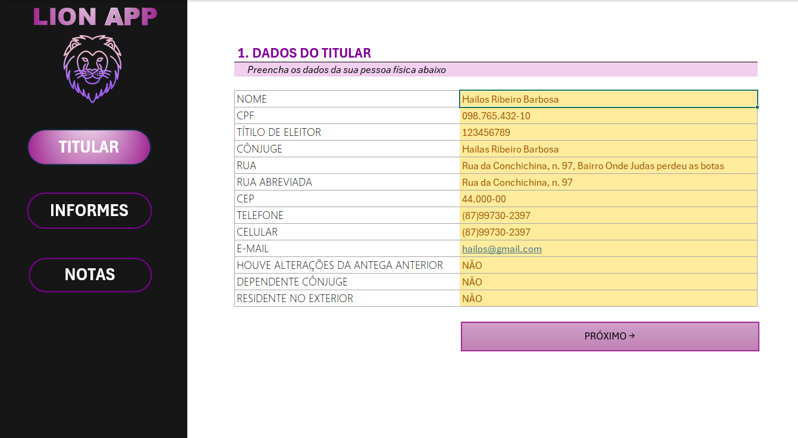
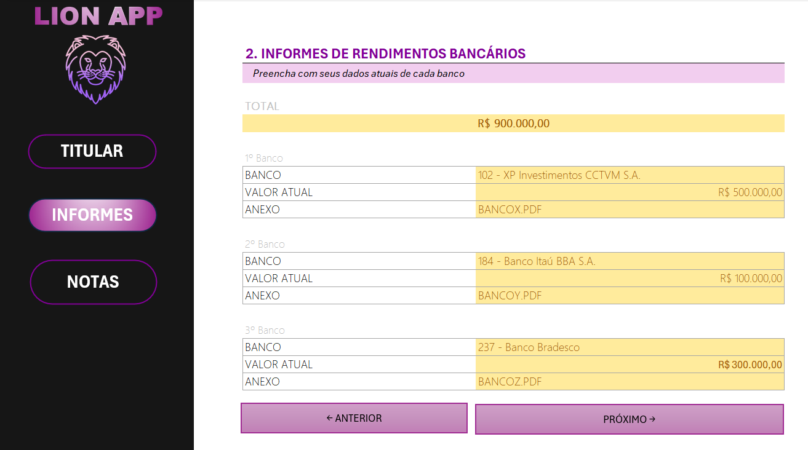
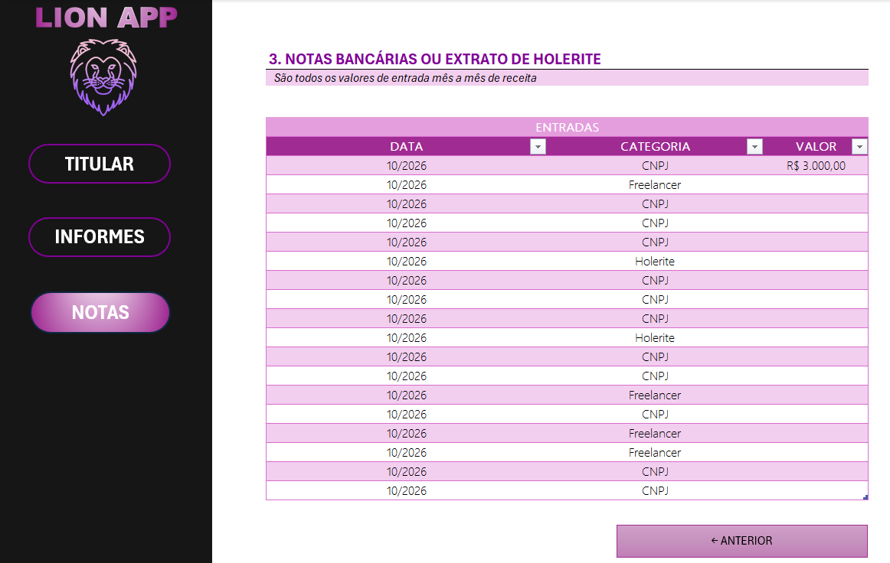

# 🦁 Lion App — Organizador de Declaração de Imposto de Renda

Planilha em **Microsoft Excel** que funciona como um pequeno aplicativo para **organizar, em um só lugar, as informações necessárias para a Declaração de Imposto de Renda de Pessoa Física (IRPF)**.

Em vez de juntar dados espalhados em papéis, e-mails e extratos, o usuário preenche três telas guiadas: **dados do titular**, **informes de rendimentos bancários** e **notas/entradas mensais**. No fim, tem tudo pronto para consultar na hora de declarar ou para enviar ao contador.

> Projeto desenvolvido no bootcamp **Santander + DIO — Excel e IA**.

---

## 📸 Telas

### 1. Dados do Titular
Cadastro da pessoa física: nome, CPF, título de eleitor, cônjuge, endereço, contatos e perguntas de "sim/não" exigidas na declaração.

### 2. Informes de Rendimentos Bancários
Registro de até três bancos, com o saldo/valor atual e o nome do arquivo do informe anexado. O **total** é calculado automaticamente.

### 3. Notas Bancárias ou Extrato de Holerite
Tabela com todas as entradas de receita mês a mês, classificadas por categoria.

---

## ✨ Funcionalidades

- **Navegação estilo app**: menu lateral (Titular, Informes, Notas) e botões **Próximo →** / **← Anterior** que levam de uma tela a outra, feitos com formas e hiperlinks internos — **sem macros (VBA)**, então o arquivo abre sem alertas de segurança.
- **Listas suspensas (validação de dados)** para evitar erros de digitação:
  - Campos de **SIM / NÃO** na tela do Titular (alterações desde a entrega anterior, cônjuge dependente, residente no exterior);
  - **Banco** escolhido a partir de uma lista com os principais bancos brasileiros e seus códigos (ex.: `237 - Banco Bradesco`), com mensagem de orientação e de erro;
  - **Categoria** da entrada: `Holerite`, `CNPJ` ou `Freelancer`.
- **Cálculo automático** do total dos informes bancários (`=SOMA(...)`).
- **Tabela estruturada** na tela de Notas, com filtros por data, categoria e valor.
- **Identidade visual própria**: tema escuro no menu, tons de roxo/rosa e campos de preenchimento destacados em amarelo.

---

## 🗂️ Estrutura da planilha

| Aba | Função |
|---|---|
| **Titular** | Dados cadastrais da pessoa física |
| **Informes** | Bancos, valores atuais e anexos dos informes de rendimentos |
| **Notas** | Entradas mensais de receita (holerite, CNPJ, freelancer) |
| **Relação - bancos** | Aba de apoio com a lista de bancos usada na lista suspensa |

---

## 🚀 Como usar

1. Baixe o arquivo `Projeto - Organizador de Declaração de Imposto de Renda.xlsx`.
2. Abra no **Microsoft Excel** (recomendado o Excel 365 / 2021 ou superior).
3. Comece pela tela **Titular** e preencha as células em amarelo.
4. Clique em **Próximo →** para ir aos **Informes** e selecione os bancos na lista.
5. Na tela **Notas**, registre cada entrada de receita com data, categoria e valor.
6. Use o menu lateral para voltar a qualquer tela quando quiser.

> ⚠️ Os dados que aparecem nas imagens e no arquivo são **fictícios**, usados apenas como exemplo.

---

## 🛠️ Tecnologias e recursos do Excel

- Microsoft Excel
- Validação de dados (listas suspensas com mensagens de entrada e de erro)
- Fórmulas (`SOMA`)
- Tabelas estruturadas com filtro
- Formas com hiperlinks para navegação entre abas
- Formatação personalizada para simular a interface de um app

---

## 👤 Autora

Feito por **Danielle** — [LinkedIn](https://www.linkedin.com/in/danielleribeirob)
